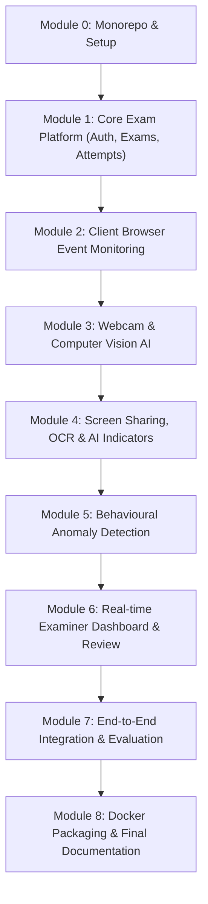

# ProctorAI — Synchronous Module Execution Roadmap & Progress Tracker

> **Project:** ProctorAI — Intelligent Online Examination Monitoring & Anomaly Detection System  
> **Approach:** Synchronous, Module-by-Module Implementation  
> **Status Legend:**  
> - ⏳ **PENDING** — Waiting for predecessor modules to complete  
> - 🟡 **IN PROGRESS** — Currently active module  
> - ✅ **COMPLETED** — Verified, tested, and signed off  
> - ⛔ **BLOCKED** — Needs external resolution before proceeding  

---

## 📌 Synchronous Working Protocol

To guarantee high code quality, stability, and zero regressions:
1. **Strict Linearity**: We do not jump ahead to subsequent modules (e.g., CV or ML) until the previous module is completely functional and verified.
2. **Definition of Done (DoD) per Module**:
   - Backend APIs tested and verified.
   - Frontend UI responsive, connected, and error-free.
   - Database schemas and relationships intact.
   - Acceptance checklist 100% checked.
3. **Audit Trail**: After each module/sub-module, update this tracker file with date, status, files created, and test outcomes.

---

## 💻 Environment & Tools Status

| Tool / Service | Status | Version / Details | Notes |
| :--- | :---: | :--- | :--- |
| **Node.js** | ✅ Ready | `v24.16.0` | Global runtime available |
| **npm** | ✅ Ready | `11.13.0` | Use `npm.cmd` on Windows PowerShell |
| **Git** | ✅ Ready | `2.53.0.windows.2` | Version control available |
| **Python** | ✅ Ready | `3.12.10` | Python runtime for AI service |
| **PostgreSQL** | ✅ Ready | PostgreSQL 18 Service (`Running`) | Binaries at `C:\Program Files\PostgreSQL\18\bin` |

---

## 🗺️ Master Synchronous Implementation Plan

---

## 📦 Module 0: Monorepo Foundation & Scaffolding
- [x] **0.1 Initialize Project Monorepo Structure**
  - [x] Create folder structure (`frontend/`, `backend/`, `ai-service/`, `docs/`, `storage/`)
  - [x] Add root `.gitignore`
  - [x] Add `.env.example` templates
- [x] **0.2 Verification**: Clean directory structure matching blueprint specification.

---

## 📦 Module 1: Core Examination Platform (Phase 1)
*Goal: Working end-to-end examination platform (Auth, Role-Based Access, Exam Management, Timed Question Interface, Answer Submission, and Result Calculation).*
*Status: ✅ COMPLETED & VERIFIED (2026-11-24)*

### 1.1 Backend Scaffolding & Database Schema
- [x] Initialize `backend/` with Node.js, Express, TypeScript, and Prisma 6
- [x] Create `proctor_ai` PostgreSQL database
- [x] Implement Prisma Schema (`User`, `Exam`, `Question`, `Option`, `ExamAttempt`, `Answer`, `ProctorEvent`, `Evidence`, `AnomalyScore`, `ReviewRecord`)
- [x] Run initial Prisma migration (`initial_schema`) & generate client
- [x] Setup Express server with CORS, dotenv, JSON parsing, and `/api/health`

### 1.2 Authentication & Role-Based Authorization
- [x] Implement password hashing with `bcryptjs`
- [x] Implement JWT token issuance and verification
- [x] Create auth routes & controllers:
  - `POST /api/auth/register` (Candidate registration)
  - `POST /api/auth/login` (Authentication)
  - `GET /api/auth/me` (Token validation / Current user profile)
- [x] Implement RBAC middleware (`authenticate`, `authorize(["ADMIN", "EXAMINER", "CANDIDATE"])`)
- [x] Seed script for default Admin, Examiner, Candidate, and Sample Exam (`npm run db:seed`)

### 1.3 Exam & Question Management API (Examiner / Admin)
- [x] Create Exam routes & controllers:
  - `POST /api/exams` (Create exam with title, duration, schedule)
  - `GET /api/exams` (List exams with role filtering)
  - `GET /api/exams/:id` (Get detailed exam info)
  - `PUT /api/exams/:id` (Update/Publish exam status)
- [x] Create Question routes & controllers:
  - `POST /api/exams/:id/questions` (Add MCQ / Descriptive questions)
  - `DELETE /api/questions/:id` (Remove questions)
  - `GET /api/exams/:id/questions` (Get questions — sanitized `isCorrect` for candidates)

### 1.4 Attempt & Answer Submission Engine (Candidate)
- [x] Create Attempt routes & controllers:
  - `POST /api/attempts` (Start exam attempt, enforce time window & single active attempt)
  - `GET /api/attempts/:id` (Fetch candidate's current attempt with sanitized questions)
  - `POST /api/attempts/:id/answers` (Autosave / update MCQ selection)
  - `POST /api/attempts/:id/submit` (Submit exam, server-side timer validation, auto-grade MCQs)
  - `GET /api/attempts/exam/:examId/results` (Examiner view of candidate attempts and scores)
  - `GET /api/attempts/:id/result` (Candidate view of their evaluated submission)

### 1.5 Frontend Foundation & Layout
- [x] Initialize `frontend/` with Vite + React + TypeScript + Tailwind CSS
- [x] Install dependencies: `lucide-react`, `react-router-dom`, `axios`, `react-hook-form`, `zod`
- [x] Build global layout components: Navigation, Header, Role Badges, Auth State Provider

### 1.6 Frontend Authentication & Protected Routes
- [x] Candidate & Examiner Login page (`/login`)
- [x] Candidate Registration page (`/register`)
- [x] Role-based route guard (`ProtectedRoute` for Admin, Examiner, Candidate)

### 1.7 Examiner Portal Interface
- [x] Examiner Dashboard (`/examiner`): Overview of created exams
- [x] Exam Creation / Edit page (`/examiner/exams/create`)
- [x] Question Builder UI (Add MCQ options, mark correct answer, set marks)
- [x] Submissions & Results Viewer (`/examiner/exams/:id/results`)

### 1.8 Candidate Examination Experience
- [x] Candidate Dashboard (`/candidate`): Available, ongoing, and past exams
- [x] Exam Instructions & System Check Page (`/candidate/exam/:id/instructions`)
- [x] Fullscreen Exam Interface (`/candidate/exam/:id`):
  - Question navigation sidebar (Answered, Unanswered, Current)
  - Countdown timer synchronized with backend
  - Option selector and autosave feedback
  - Final review and submit modal
- [x] Result / Completion screen (`/candidate/results/:id`)

### 1.9 Module 1 Verification & Sign-Off
- [x] End-to-end automated test (`backend/src/test-phase1-e2e.ts`): Admin/Examiner creates exam -> Candidate takes exam -> Answers auto-saved -> Candidate submits -> Marks calculated -> Examiner views results -> 100% passed.

---

## 📦 Module 2: Browser Activity Monitoring (Phase 2)
*Goal: Detect client-side browser anomalies: tab switches, window blur, fullscreen exits, copy/paste, and summarize interaction dynamics.*
*Status: ✅ COMPLETED & VERIFIED (2026-11-24)*

### 2.1 Client Monitoring Hook & Collectors
- [x] `useProctorMonitor` React hook for exam interface
- [x] Page visibility listener (`visibilitychange` -> `TAB_HIDDEN` / `TAB_VISIBLE`)
- [x] Window focus & blur listener (`blur` -> `WINDOW_BLUR`, `focus` -> `WINDOW_FOCUS`)
- [x] Fullscreen change & exit detector (`FULLSCREEN_EXIT` / `FULLSCREEN_ENTER`)
- [x] Clipboard interception (`copy` -> `COPY_ATTEMPT`, `paste` -> `PASTE_ATTEMPT`)
- [x] Context menu / shortcut prevention (`contextmenu`, inspect shortcuts blocked & logged: `DEVTOOLS_SHORTCUT`)

### 2.2 Mouse & Keyboard Interaction Summarizer
- [x] Throttled mouse movement summarizer (activity bursts vs prolonged inactivity)
- [x] Scroll frequency and speed tracker
- [x] Keyboard cadence metadata collector (keyPressCount, no raw keys or password logging)
- [x] Periodic `INTERACTION_SUMMARY` emission (flushed every 30 seconds)

### 2.3 Backend Event Ingestion Pipeline
- [x] `POST /api/proctor/events` endpoint:
  - Validates attempt ownership & active status
  - Throttled batch event ingestion with Zod validation
  - Stores events in PostgreSQL `proctor_events` table with ISO timestamp & metadata
- [x] `GET /api/proctor/attempts/:attemptId/events`:
  - Retrieves chronological audit trail and severity breakdown (INFO, LOW, MEDIUM, HIGH, CRITICAL)
- [x] Examiner UI Proctoring Telemetry Audit Modal in `ExamResultsPage`

### 2.4 Module 2 Verification & Sign-Off
- [x] Live automated test (`backend/src/test-phase2-e2e.ts`) verifying:
  - Multi-category browser event ingestion (Tab hidden, Blur, Copy, Paste, DevTools shortcut, Interaction summary)
  - Strict attempt authorization (foreign attempts blocked from injection)
  - Examiner severity aggregation & event audit trail
  - Permanent persistence after attempt submission
  - 100% passed.

---

## 📦 Module 3: Webcam & Computer Vision Proctoring (Phase 3)
*Goal: Permission-based candidate video analysis for presence, head pose/gaze deviations, and mobile phone detection.*
*Status: ✅ COMPLETED & VERIFIED (2026-11-24)*

### 3.1 Python AI Service Setup
- [x] Initialize `ai-service/` with FastAPI, Uvicorn, OpenCV, MediaPipe, Ultralytics YOLOv8
- [x] Configure `requirements.txt` and dedicated Python virtual environment (`ai-service/venv`)
- [x] Implement AI microservice health endpoint (`GET /health`)

### 3.2 Candidate Webcam & Consent Interface
- [x] Browser `MediaDevices.getUserMedia` integration
- [x] Floating webcam preview component (`WebcamMonitor.tsx`) with persistent "Camera Active" badge
- [x] Periodic secure frame sampling (every 3.5s canvas captures at 480x360 JPEG)
- [x] Overlay dynamic detection state indicators (Face Centered, Looking Away, Face Missing, Phone Detected)

### 3.3 Computer Vision Pipeline
- [x] **Face Presence & Multi-Face Detector** (`face_detector.py`: MediaPipe + OpenCV Cascade fallback)
- [x] **Head Pose & Looking Away Analysis** (`head_pose.py`: yaw, pitch, roll tracking with explainable thresholds)
- [x] **Mobile Phone & Device Detection** (`phone_detector.py`: Ultralytics YOLOv8n cell phone detection)

### 3.4 Integration & Event Reporting
- [x] Express backend proxy/relay (`POST /api/proctor/attempts/:attemptId/frame`) with Multer buffer handling
- [x] Auto-logging of high-confidence anomalies to `proctor_events`
- [x] Automated frame snapshot preservation in `storage/evidence/` and DB indexing in `evidence` table
- [x] Module 3 Verification & Sign-Off (`backend/src/test-phase3-e2e.ts` passed 100%).

---

## 📦 Module 4: Screen Monitoring, OCR & AI Indicators (Phase 4)
*Goal: Authorized screen sharing, screen text OCR, and external tool indicators.*
*Status: ✅ COMPLETED & VERIFIED (2026-11-24)*

### 4.1 Screen Capture Consent & Streaming
- [x] Browser Screen Capture API (`getDisplayMedia`) with explicit prompt (`ScreenMonitor.tsx`)
- [x] Candidate indicator showing active screen sharing status in test header
- [x] Handled screen share stop events (`track.onended` -> logs `SCREEN_SHARE_STOPPED` alert)
- [x] Periodic frame capture (every 6 seconds offscreen canvas to JPEG)

### 4.2 OCR & Visual Text Analysis
- [x] Python AI microservice EasyOCR pipeline (`ocr_service.py`)
- [x] OCR text extraction from shared display surface frames
- [x] Curated detection scanner for external AI assistants (`ChatGPT`, `Claude`, `Gemini`, `Copilot`, `OpenAI`, etc.) and unauthorized homework platforms (`Chegg`, `Course Hero`, `Brainly`, `Quizlet`, `Stack Overflow`)

### 4.3 External AI Tool Correlation & Evidence Preservation
- [x] Explainable anomaly classification: `EXTERNAL_AI_INDICATOR` & `UNAUTHORIZED_RESOURCE_INDICATOR` (severity `HIGH`)
- [x] Express backend relay (`POST /api/proctor/attempts/:attemptId/screen-frame`)
- [x] Automatic event insertion into PostgreSQL `proctor_events`
- [x] Evidence snapshot saved to `storage/evidence/screen_<attemptId>_<timestamp>.jpg` and indexed in `evidence` table
- [x] Module 4 Verification & Sign-Off (`backend/src/test-phase4-e2e.ts` passed 100%).

---

## 📦 Module 5: Behavioural Anomaly Detection Engine (Phase 5)
*Goal: Feature aggregation, correlation rule engine, Isolation Forest scoring, and explainable risk levels.*
*Status: ✅ COMPLETED & VERIFIED (2026-11-24)*

### 5.1 Behavioural Feature Extraction
- [x] Aggregate candidate session metrics (`feature_extractor.py`):
  - Count & duration of tab hidden / window blurs
  - Copy/paste count
  - Face missing duration & multi-face count
  - Phone detection occurrences
  - Interaction cadence metrics
  - External indicator counters

### 5.2 Rule-Based Correlation Engine
- [x] Multi-signal correlation rules (`rule_engine.py`):
  - *Rule 1:* Blur / tab switch followed within 20s by Paste event (`BLUR_PASTE_SEQUENCE`)
  - *Rule 2:* Multi-face detected simultaneously with mobile phone (`MULTI_FACE_AND_PHONE`)
  - *Rule 3:* DevTools inspection shortcuts attempted (`DEVTOOLS_INSPECTION_ATTEMPT`)
  - *Rule 4:* External AI assistants or unauthorized resources detected (`EXTERNAL_AI_ASSISTANT_INDICATOR`)
  - *Rule 5:* Frequent focus loss across multiple intervals (`FREQUENT_FOCUS_LOSS`)
  - *Rule 6:* Face absent across multiple intervals (`PROLONGED_FACE_ABSENCE`)

### 5.3 Isolation Forest & Explainability
- [x] Python anomaly detector using Scikit-Learn `IsolationForest` (`isolation_forest_model.py`)
- [x] Blended score: 65% deterministic rules + 35% unsupervised Isolation Forest (0.0 to 100.0)
- [x] Produce explainable Risk Level (`LOW`, `MEDIUM`, `HIGH`, `CRITICAL`)
- [x] Generate JSON explanation listing contributing factors for human examiner review
- [x] Persist scores in `anomaly_scores` table upon exam submission and via on-demand API
- [x] Examiner Results View updated with risk badges and breakdown modal card

### 5.4 Module 5 Verification & Sign-Off
- [x] Automated test script (`backend/src/test-phase5-e2e.ts`): Verified normal session evaluates to LOW risk (18.2) and anomalous multi-signal session evaluates to HIGH risk (68.2) with BLUR_PASTE_SEQUENCE, DEVTOOLS_INSPECTION_ATTEMPT, and EXTERNAL_AI_ASSISTANT_INDICATOR rule violations. Examiner results API verified -> 100% passed.

---

## 📦 Module 6: Real-Time Examiner Monitoring & Dashboard (Phase 6)
*Goal: Live proctoring monitor with Socket.IO alerts, candidate activity timelines, and human examiner audit/verdict actions.*
*Status: ✅ COMPLETED & VERIFIED (2026-11-24)*

### 6.1 Real-Time Socket.IO Infrastructure
- [x] Backend Socket.IO server (`socket.ts`) with room scoping (`exam:<id>`, `attempt:<id>`)
- [x] Client Socket.IO service (`socket.service.ts`) with automatic reconnection and JWT authentication
- [x] Real-time event broadcasting (Candidate blur, CV alert, phone detected, OCR AI indicators)
- [x] Examiner-to-candidate direct warning dispatch (`examiner:warn_candidate` -> `candidate:warning`)

### 6.2 Examiner Live Proctoring Dashboard (`/examiner/exams/:id/live`)
- [x] Live candidate cards with real-time status pills (Tab focus, Face position, Phone detection, OCR AI status)
- [x] Real-time streaming alert feed with severity color coding (`INFO`, `LOW`, `MEDIUM`, `HIGH`, `CRITICAL`) and audible warning chimes
- [x] Direct candidate warning action with custom messages and pre-defined quick presets
- [x] Live human verdict action modal directly on the monitoring interface

### 6.3 Candidate Event Timeline & Evidence Review
- [x] Chronological event timeline view per candidate attempt in both Live Monitor and Exam Results
- [x] Real-time alert stream and audit trail with JSON metadata inspection
- [x] Explainable anomaly breakdown linking rules and Isolation Forest scores

### 6.4 Human Review & Audit Record
- [x] Examiner review decision actions (`CLEARED`, `FLAGGED_FOR_INQUIRY`, `DISQUALIFIED`)
- [x] Mandatory examiner notes and justification field
- [x] Store human decision in PostgreSQL `review_records` table
- [x] Ingest review records into examiner exam results table and audit modal

### 6.5 Module 6 Verification & Sign-Off
- [x] Automated test script (`backend/src/test-phase6-e2e.ts`): Verified real-time alert delivery from candidate to examiner room, verified real-time warning delivery from examiner to candidate attempt, verified review decision creation (`FLAGGED_FOR_INQUIRY`), and verified audit persistence in PostgreSQL and results API -> 100% passed.

---

## 📦 Module 7: Integration, Testing & Security Hardening (Phase 7)
- [ ] Full end-to-end integration test across all 3 tiers (Frontend, Node.js Backend, Python AI Service)
- [ ] Security hardening: Rate limiting (`express-rate-limit`), Helmet security headers, sanitization
- [ ] Candidate privacy validation: verify no raw passwords or keystrokes logged, clear retention tags
- [ ] False-positive calibration with baseline student testing sessions.

---

## 📦 Module 8: Packaging, Deployment & Documentation (Phase 8)
- [ ] `docker-compose.yml` for unified local deployment (PostgreSQL + Node Backend + Python AI + Frontend)
- [ ] Documentation suite:
  - `docs/architecture.md`
  - `docs/api-documentation.md`
  - `docs/database-design.md`
- [ ] Project README & Video demonstration script.

---

## 📝 Current Progress & Next Steps

| Milestone | Target | Status | Completion Date |
| :--- | :--- | :---: | :--- |
| **Module 0** | Monorepo Scaffolding & Git Init | ✅ COMPLETED | 2026-11-24 |
| **Module 1** | Core Exam Platform (Auth, Exams, Attempts, UI) | ✅ COMPLETED | 2026-11-24 |
| **Module 2** | Client Browser Activity Monitoring | ✅ COMPLETED | 2026-11-24 |
| **Module 3** | Webcam & Computer Vision (OpenCV/YOLO) | ✅ COMPLETED | 2026-11-24 |
| **Module 4** | Screen Sharing, OCR & AI Indicators | ✅ COMPLETED | 2026-11-24 |
| **Module 5** | Behavioural Anomaly Detection Engine | 🟡 NEXT | Ready to start |
| **Module 6** | Real-Time Live Examiner Dashboard | ⏳ PENDING | - |
| **Module 7** | Full Integration & Security Hardening | ⏳ PENDING | - |
| **Module 8** | Docker Deployment & Final Docs | ⏳ PENDING | - |

> 🎯 **Current Milestones Completed:** Modules 0, 1, 2, 3, and 4 are fully implemented, typed, and verified with automated end-to-end integration tests.
> 🎯 **Immediate Next Step:** Begin **Module 5: Behavioural Anomaly Detection Engine** (feature aggregation from session events, multi-signal correlation rule engine, Scikit-learn Isolation Forest unsupervised scoring, explainable risk tiering `LOW`/`MEDIUM`/`HIGH`/`CRITICAL`, and DB persistence in `anomaly_scores`).
