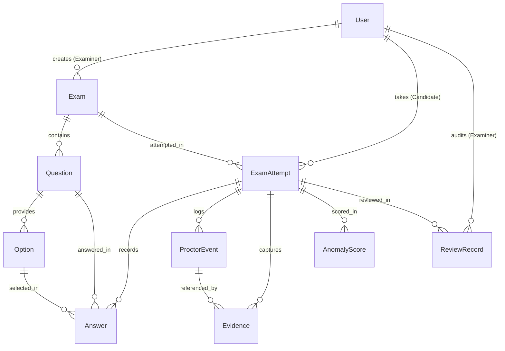

# ProctorAI Database Design & Entity Relationship

ProctorAI uses PostgreSQL 16+ managed through Prisma ORM with strict referential integrity and foreign key constraints.

---

## 1. Entity-Relationship Overview

---

## 2. Table Specifications

### 2.1 `User` (`users`)
Stores user accounts and role assignments.
| Column | Type | Constraints | Description |
| :--- | :--- | :--- | :--- |
| `id` | UUID | Primary Key | Unique user identifier |
| `email` | String | Unique, Indexed | User email address |
| `password` | String | Not Null | Bcrypt hashed password |
| `fullName` | String | Not Null | Display name |
| `role` | Enum | Default `CANDIDATE` | `ADMIN`, `EXAMINER`, `CANDIDATE` |
| `createdAt` | DateTime | Default `now()` | Timestamp |
| `updatedAt` | DateTime | Auto-updated | Timestamp |

### 2.2 `Exam` (`exams`)
Examinations authored by examiners.
| Column | Type | Constraints | Description |
| :--- | :--- | :--- | :--- |
| `id` | UUID | Primary Key | Unique exam identifier |
| `title` | String | Not Null | Exam title |
| `description` | Text | Nullable | Exam instructions |
| `durationMinutes`| Integer | Default 60 | Max duration in minutes |
| `totalMarks` | Float | Default 0 | Computed sum of question marks |
| `status` | Enum | Default `DRAFT` | `DRAFT`, `PUBLISHED`, `CLOSED` |
| `createdBy` | UUID | FK -> `users(id)` | Author reference |
| `createdAt` | DateTime | Default `now()` | Timestamp |

### 2.3 `Question` (`questions`) & `Option` (`options`)
Stores exam questions and multiple choice answers.
- `Question.questionType`: `MCQ` or `DESCRIPTIVE`.
- `Option.isCorrect`: Boolean indicating correct answer. Stripped when served to candidates before submission.

### 2.4 `ExamAttempt` (`exam_attempts`)
Candidate exam sessions.
- Constraint: `@@unique([examId, candidateId])` prevents duplicate attempts.
- `status`: `IN_PROGRESS`, `SUBMITTED`, `AUTO_SUBMITTED`, `EVALUATED`.
- `totalScore`: Computed grade upon submission.

### 2.5 `ProctorEvent` (`proctor_events`)
Chronological audit stream of proctoring events.
- `eventType`: String code (`TAB_HIDDEN`, `WINDOW_BLUR`, `DEVTOOLS_SHORTCUT`, `PHONE_DETECTED`, `LOOKING_AWAY`, `EXTERNAL_AI_INDICATOR`, etc.).
- `severity`: `INFO`, `LOW`, `MEDIUM`, `HIGH`, `CRITICAL`.
- `metadata`: JSON payload containing context (e.g. key shortcut, YOLO confidence, OCR text match).
- Indexed on: `[attemptId, createdAt]` and `[eventType]`.

### 2.6 `Evidence` (`evidence`)
Preserved visual snapshots.
- `filePath`: Relative disk path (`storage/evidence/evidence_<id>.jpg` or `screen_<id>.jpg`).
- `fileType`: MIME type (`image/jpeg`).
- Links to `attemptId` and optional `eventId`.

### 2.7 `AnomalyScore` (`anomaly_scores`)
Behavioural risk evaluation output.
- `score`: Float (0.0 to 100.0).
- `riskLevel`: `LOW`, `MEDIUM`, `HIGH`, `CRITICAL`.
- `explanation`: Detailed JSON containing contributing rule violations and ML Isolation Forest sub-scores.
- `modelVersion`: Tracking string (e.g. `IsolationForest-Rules-v1.0`).

### 2.8 `ReviewRecord` (`review_records`)
Official human examiner decision and reasoning.
- `reviewerId`: FK -> `users(id)`.
- `decision`: `CLEARED`, `FLAGGED_FOR_INQUIRY`, `DISQUALIFIED`.
- `notes`: Justification text for institutional audit.
